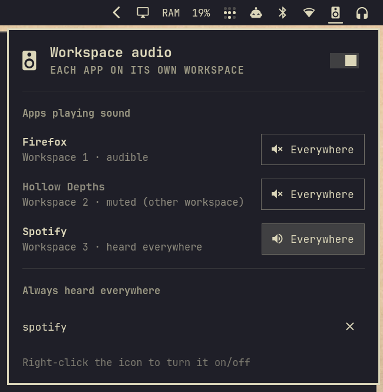

# Workspace audio for Omarchy

Each app is only heard on the workspace its window is on. Start a game on
workspace 2, switch to workspace 1, and the game goes quiet; come back and the
sound returns. Music players can be marked **audible everywhere** so Spotify
keeps playing wherever you are.



## Features

- Mutes apps whose window is not on a visible workspace (all monitors and the
  special workspace count as visible), and unmutes them when you come back.
- **Audible everywhere** exceptions per app: one click in the panel, a
  keybinding, or the button on the notification shown the first time an app is
  muted. Spotify is in the list by default.
- **On/off switch** in the panel, or right-click the bar icon.
- Never touches what you did yourself: a stream you muted stays muted, a stream
  you unmuted by hand is left alone.
- Works with browsers (audio from a child process) and with sandboxed apps
  such as firejail games (matched by binary/app name when the PID is
  namespaced).
- English and French.

## Install

```bash
omarchy plugin add https://github.com/rustyhammer/omarchy-workspace-audio --enable
```

The widget starts its daemon on its own; nothing to add to `autostart.lua`.

Needs `python3`, `pactl`, `hyprctl` and `notify-send`, all present on a stock
Omarchy install (PipeWire with its PulseAudio layer).

### Optional keybindings

Add to `~/.config/hypr/bindings.lua`:

```lua
local wa = os.getenv("HOME") .. "/.config/omarchy/plugins/rustyhammer.workspace-audio/bin/workspace-audio"
o.bind("SUPER + ALT + A", "Workspace audio: focused app everywhere", wa .. " follow")
o.bind("SUPER + CTRL + SHIFT + A", "Workspace audio: on/off", wa .. " toggle")
```

Check the keys are free first with `omarchy menu keybindings --print`.

## Usage

| Action | How |
| --- | --- |
| Open the panel | Left-click the speaker icon |
| Turn on/off | Right-click the icon, or the switch in the panel |
| Make an app audible everywhere | **Everywhere** in the panel, the notification button, or `workspace-audio follow` |
| Remove an exception | ✕ next to it in the panel |

The icon is dimmed when the feature is off, and uses the accent colour while
it is muting something.

Command line (`bin/workspace-audio`): `on`, `off`, `toggle`, `follow`,
`global <window-class>`, `status`.

Files:

- `~/.config/workspace-audio/global-apps`: window classes audible everywhere,
  one per line (editable by hand)
- `~/.config/workspace-audio/disabled`: present when turned off
- `$XDG_RUNTIME_DIR/workspace-audio.json`: live status read by the widget

## How it works

A small Python daemon listens to Hyprland's event socket and to
`pactl subscribe`. On every workspace change, window move or new audio stream
it maps each PipeWire stream to its window (process tree first, then binary
or app name against the window class) and mutes or unmutes it.

WirePlumber remembers mute per application and re-applies it when an app
recreates its stream (Chrome does on every pause), so the daemon tracks the
apps it muted by name and treats such a stream as its own.

Stopping the daemon unmutes everything it muted.

## Known limits

- Tested on a single monitor with Chrome, Spotify and a firejail-sandboxed
  game. Steam/Proton games and multi-monitor setups have not been tested
  yet; reports are welcome.
- An app whose stream can't be matched to a window is never muted.
- An app with windows on several workspaces is heard as long as one of them
  is visible.

## Uninstall

```bash
omarchy plugin remove rustyhammer.workspace-audio
```

## Development

```bash
python3 -m unittest discover -s tests
omarchy plugin validate .
```

## License

MIT
